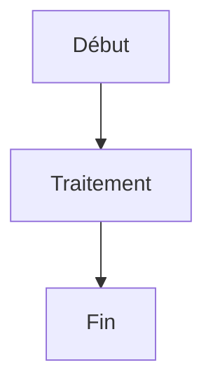

# 📚 Documentation avec MkDocs

Ce projet utilise [MkDocs](https://www.mkdocs.org/) avec le thème [Material](https://squidfunk.github.io/mkdocs-material/) pour générer une documentation web moderne et interactive.

## 🚀 Démarrage rapide

### Installation

```bash
# Installer MkDocs et les dépendances
python3 -m pip install --user -r requirements.txt
```

### Développement local

```bash
# Lancer le serveur de développement
export PATH="$HOME/.local/bin:$PATH"
mkdocs serve

# Ouvrir http://localhost:8000 dans votre navigateur
```

### Construction pour production

```bash
# Générer le site statique
mkdocs build

# Les fichiers sont dans le dossier site/
```

## 📁 Structure du projet

```
apple-game/
├── mkdocs.yml          # Configuration MkDocs
├── requirements.txt    # Dépendances Python
├── docs/               # Contenu de la documentation
│   ├── index.md        # Page d'accueil
│   ├── GETTING_STARTED.md
│   ├── ARCHITECTURE.md
│   └── ...             # Autres pages
└── site/               # Site généré (après build)
```

## ✏️ Écriture de documentation

### Format Markdown

Utilisez la syntaxe Markdown standard avec extensions :

```markdown
# Titre principal

## Sous-titre

**Texte en gras** et *italique*

- Liste à puces
- Avec éléments

1. Liste numérotée
2. Avec ordre

[Liens](url) et 

> Citations

`Code inline` et blocs de code :

```gdscript
# Exemple GDScript
func _ready():
    print("Hello World!")
```
```

### Extensions spéciales

#### Onglets

```markdown
=== "Linux"
    Commande Linux

=== "macOS"
    Commande macOS

=== "Windows"
    Commande Windows
```

#### Détails repliables

```markdown
??? note "Note importante"
    Contenu caché par défaut

??? tip "Astuce"
    Conseil utile

??? warning "Attention"
    Mise en garde
```

#### Annotations de code

```python
def fonction():
    code # (1)!
```

1. Explication de cette ligne

#### Diagrammes Mermaid



## 🎨 Thème Material

### Fonctionnalités

- **Mode sombre/clair** automatique
- **Recherche intégrée** avec suggestions
- **Navigation intuitive** par onglets
- **Révisions Git** avec dates
- **Auteurs des commits** affichés
- **Code syntax highlighting**
- **Responsive design** pour mobile

### Personnalisation

Modifiez `mkdocs.yml` pour :

- Changer les couleurs (`primary`, `accent`)
- Ajouter des icônes
- Configurer la navigation
- Personnaliser les extensions Markdown

## 🚀 Déploiement

### GitHub Pages

1. **Configuration repository** :
   - Settings → Pages
   - Source: "GitHub Actions"

2. **Workflow GitHub Actions** (`.github/workflows/docs.yml`) :

```yaml
name: docs
on:
  push:
    branches: [main]
  pull_request:
    branches: [main]

jobs:
  deploy:
    runs-on: ubuntu-latest
    steps:
      - uses: actions/checkout@v4
      - uses: actions/setup-python@v4
        with:
          python-version: 3.x
      - run: pip install -r requirements.txt
      - run: mkdocs gh-deploy --force
```

### Autres plateformes

- **Netlify** : Connexion GitHub automatique
- **Vercel** : Import depuis Git
- **GitLab Pages** : CI/CD intégré

## 📝 Bonnes pratiques

### Organisation

- Un fichier par concept/fonctionnalité
- Index dans chaque sous-dossier
- Liens entre pages pour navigation
- Images dans `docs/assets/images/`

### Contenu

- **Français** comme langue principale
- **Exemples concrets** avec code
- **Captures d'écran** pour l'interface
- **Diagrammes** pour l'architecture
- **Mises à jour régulières**

### Maintenance

- Vérifier les liens cassés : `mkdocs build --strict`
- Prévisualiser avant commit : `mkdocs serve`
- Commits atomiques pour la doc
- Reviews pour changements importants

## 🔧 Commandes utiles

```bash
# Serveur de développement
mkdocs serve

# Construction
mkdocs build

# Validation (liens, syntaxe)
mkdocs build --strict

# Déploiement GitHub Pages
mkdocs gh-deploy --force

# Nouvelle page
mkdocs new docs/nouvelle-page.md

# Aide
mkdocs --help
```

## 📞 Support

- [Documentation MkDocs](https://www.mkdocs.org/)
- [Thème Material](https://squidfunk.github.io/mkdocs-material/)
- [Extensions PyMdown](https://facelessuser.github.io/pymdown-extensions/)

---

**🎯 Cette documentation est elle-même générée avec MkDocs !**