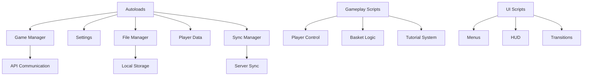

# 📜 Scripts GDScript

Cette page donne une vue d'ensemble des scripts principaux du projet AppleGame.
L'objectif est de documenter l'architecture des scripts plutôt que chaque fichier individuellement.

## Rôle des scripts

Les scripts du répertoire `Scripts/` forment la logique de jeu, l'interface utilisateur, la communication backend et les services partagés.

## Principales familles

### 🔧 Autoloads et services globaux

- `main.gd` : logique principale du jeu, cycle de vie et passage de scène.
- `game_manager.gd` : orchestrateur du jeu, connexion API et gestion des états.
- `settings.gd` : configuration globale et préférences utilisateur.
- `file_manager.gd` : sauvegarde et chargement local.
- `player_data.gd` : données persistantes du joueur.
- `sync_manager.gd` : synchronisation du jeu avec le serveur.

### 🎮 Gameplay

- `player.gd` : contrôles du joueur, collisions et interactions.
- `basket.gd` : logique de collecte et gestion du panier.
- `tutorial.gd` : déroulement du tutoriel et guidage.
- `grass_system.gd` : rendu et gestion de l'herbe.

### 🖥️ Interface utilisateur

- `main_menu.gd`, `option_menu.gd`, `break_menu.gd` : écrans de menus et navigation.
- `interface.gd` : affichage de l'interface en jeu.
- `user_menu.gd` : gestion du profil utilisateur.
- `info_menu.gd` : écran d'information.
- `gdpr_menu.gd` : conformité RGPD.

### 🔗 Backend et API

- `api.gd` : communication avec le serveur distant.
- `ui_api.gd` : interface d'API pour l'utilisateur.
- `colour_bind.gd` : adaptation des couleurs pour le mode daltonien.

### 🔄 Utilitaires

- `scene_transition.gd` : transitions entre les scènes.
- `tracer_carte.gd` : génération de la carte et aperçu de niveau.

## Architecture des scripts

## Conventions de nommage

- **snake_case** pour les variables et fonctions.
- **PascalCase** pour les classes et objets.
- Préfixe descriptif pour les variables exportées.
- Commentaires métier en français.

## Points d'entrée

Le script principal `main.gd` orchestre les autres composants et gère le cycle de vie du niveau.
